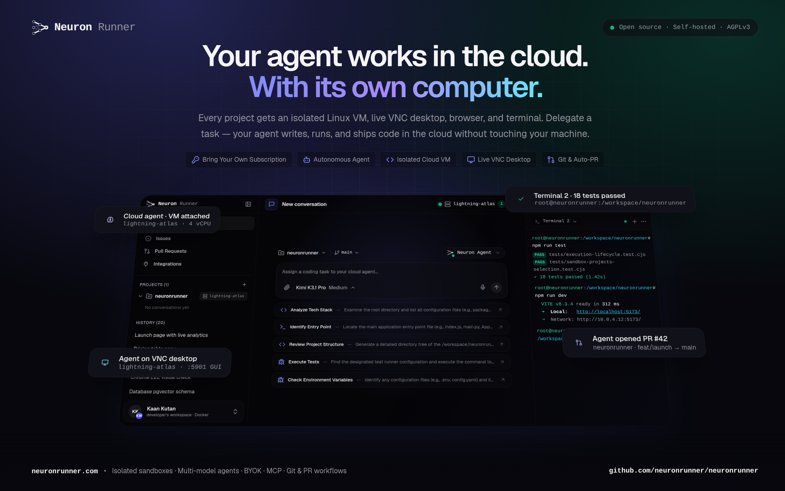

# Neuron Runner

<p align="center">
  
</p>

NeuronRunner is an open-source, self-hosted AI coding workspace and multi-model agent platform. It pairs an isolated local Docker sandbox per team workspace with streaming multi-model LLM chat, tool calling, interactive browser terminals, isolated-origin port previews, integrated Git & GitHub PR workflows, BYOK (Bring Your Own Key) provider routing, and Model Context Protocol (MCP) connectors.


---

## Architecture

```text
+-------------------------------------------------------------------------+
|                   React 19 + Vite + TypeScript Web App                  |
|  Chat | File Explorer | Code Editor | PTY Terminal | Git & PR | Browser |
+------------------------------------+------------------------------------+
                                     | HTTP (REST / SSE) + WebSocket (WS)
+------------------------------------v------------------------------------+
|                  Django 5.2 ASGI API (Daphne + Channels)                |
|   chat | sandbox | mcp | model | openai_compat | authentication | user  |
+----+-----------------------+-----------------------+--------------------+
     |                       |                       |
+----v--------+       +------v------+       +--------v---------+
| PostgreSQL  |       |    Redis    |       |  Docker Engine   |
| + pgvector  |       | - Channels  |       | - 1 container /  |
| - Users     |       | - Cache     |       |   workspace      |
| - Chats     |       | - Preview   |       | - Persistent     |
| - Memory    |       |   tokens    |       |   /workspace vol |
| - Secrets   |       | - WS tickets|       | - PTY + tools    |
+-------------+       +-------------+       +--------+---------+
                                                     |
                                            +--------v---------+
                                            | Preview Proxy    |
                                            | (port 8090)      |
                                            | Isolated origin  |
                                            +------------------+
```

## Key Features

- **Isolated Docker Sandboxes**: Every workspace gets an isolated Docker container with a persistent `/workspace` mount, memory/CPU/PID limits (`--pids-limit 256`, `--security-opt no-new-privileges`), and automatic workspace secret injection.
- **Multi-Model Chat & Tool Calling**: Stream responses from OpenAI, Anthropic, Google Gemini, OpenRouter, xAI, DeepSeek, Ollama, or any OpenAI-compatible endpoint via BYOK (workspace-level encrypted provider keys) or server-configured models.
- **OpenAI-Compatible Gateway (`/v1/chat/completions`)**: Connect external tools (Continue.dev, Open WebUI, custom scripts) using NeuronRunner API keys.
- **Interactive Browser Terminal**: Full PTY shell (`xterm.js` + Django Channels WebSocket) running inside your workspace container with one-time signed WebSocket tickets.
- **Isolated-Origin Live Port Previews**: Automatically detects HTTP servers running inside your workspace container and serves them through an isolated reverse proxy on port `8090`.
- **Integrated Git & GitHub PR Studio**: Browse branches, inspect staged/unstaged diffs, commit changes, clone repositories, and review GitHub pull requests and issues.
- **Team Workspaces & Encrypted Secrets**: Invite teammates with owner/admin/member roles, share workspace sandboxes and encrypted environment variables (`.env` bulk import supported).
- **Model Context Protocol (MCP)**: Connect remote MCP servers with OAuth/bearer auth and expose their tools directly to the chat agent.
- **Persistent Agent Memory & Notes**: Store user preferences and project/workspace notes with optional `pgvector` semantic search (gracefully falls back to lexical search when no embedding model is configured).

---

## Quick Start (Docker Compose)

### Prerequisites
- Docker Engine & Docker Compose v2
- At least one LLM API key (e.g. OpenRouter, OpenAI, Anthropic, Gemini, or a local Ollama instance)

### 1. Clone and configure environment

```bash
git clone https://github.com/neuronrunner/neuronrunner.git
cd neuronrunner
cp backend/.env.example backend/.env
```

`backend/.env` is optional for a local try-out: without it, Docker Compose uses the defaults in `backend/.env.example` (debug mode with an insecure development `SECRET_KEY`). For anything beyond local use, create `backend/.env` and set at least:
- `SECRET_KEY` (generate with `python3 -c "import secrets; print(secrets.token_urlsafe(50))"`)
- No LLM key is needed here: each workspace connects its own API key or subscription on first sign-in (the **Hello** page)

### 2. Build the sandbox image

```bash
docker build -f Dockerfile.sandbox -t neuronrunner-sandbox:latest .
```

> If you skip this step, NeuronRunner automatically falls back to `python:3.11-slim`.

### 3. Start the stack

```bash
docker compose up -d --build
```

Services will be available at:
- **Frontend**: http://localhost:3000
- **Backend API**: http://localhost:8000
- **Port Preview Proxy**: http://localhost:8090

---

## Local Development

### Backend (Django 5.2 ASGI)

```bash
cd backend
python3 -m venv .venv
source .venv/bin/activate
pip install -r requirements.txt
cp .env.example .env
python manage.py migrate
python manage.py createsuperuser
daphne -b 0.0.0.0 -p 8000 app.asgi:application
```

To enable isolated-origin local port previews in development, run the preview proxy in a second terminal:

```bash
python manage.py run_preview_proxy --host 127.0.0.1 --port 8090
```

### Frontend (React 19 + Vite 8)

```bash
cd frontend
npm ci
cp .env.example .env.local
npm run dev
```

The frontend dev server runs at http://localhost:3000 and connects to `VITE_API_URL` (`http://localhost:8000`).

---

## Project Structure

```text
.
├── Dockerfile.sandbox        # Docker image used for workspace sandboxes
├── docker-compose.yml        # Full self-hosted stack (Postgres, Redis, Backend, Proxy, Frontend)
├── backend/
│   ├── app/                  # Django settings, ASGI, root URLs, health & config endpoints
│   ├── authentication/       # JWT auth, email OTP, Google/GitHub OAuth, optional Turnstile
│   ├── chat/                 # Streaming LLM chat, tool calling, memory, notes, attachments
│   ├── mcp/                  # Model Context Protocol client, OAuth & tool execution
│   ├── model/                # Model catalog and reasoning specs
│   ├── openai_compat/        # OpenAI-compatible /v1/chat/completions proxy
│   ├── sandbox/              # Docker sandbox runtime, PTY terminal, port preview, Git, BYOK, secrets
│   └── user/                 # Custom User model, profiles, API keys
└── frontend/
    ├── src/                  # React 19 + TypeScript application
    ├── tests/                # Node test suite
    └── scripts/              # Test runner & SEO prerenderer
```

---

## Running Tests

### Backend

```bash
cd backend
python manage.py check
python manage.py test
```

### Frontend

```bash
cd frontend
npm run typecheck
npm test
npm run build
```

---

## Configuration Reference

Key environment variables in `backend/.env`:

| Variable | Description | Default |
| --- | --- | --- |
| `SECRET_KEY` | Django cryptographic secret key (required in production) | — |
| `DEBUG` | Enable debug mode (`True` / `False`) | `False` |
| `DB_ENGINE` | Database backend (`django.db.backends.postgresql` or `sqlite3`) | `sqlite3` (dev) |
| `REDIS_URL` | Redis URL for Channels, cache, WS tickets, and preview tokens | `redis://127.0.0.1:6379/0` |
| `SANDBOX_PROVIDER` | Sandbox runtime provider | `docker` |
| `DOCKER_SANDBOX_IMAGE` | Preferred Docker image for workspace sandboxes | `neuronrunner-sandbox:latest` |
| `DOCKER_SANDBOX_FALLBACK_IMAGE` | Fallback image if preferred image is not built locally | `python:3.11-slim` |
| `LOCAL_WORKSPACE_ROOT` | Host directory storing persistent workspace files | `backend/workspaces` |
| `PREVIEW_PROXY_BASE_URL` | Base URL of the isolated-origin port preview proxy | `http://127.0.0.1:8090` |
| `FRONTEND_BASE_URL` | Public URL of the frontend (used for CORS & OAuth redirects) | `http://localhost:3000` |
| `OPENROUTER_API_KEY` | Optional; only for `openrouter:` memory embeddings and admin catalog tools (chat always uses workspace keys) | — |
| `MEMORY_EMBEDDING_MODEL` | Optional embedding model (e.g. `openrouter:openai/text-embedding-3-small`) | `""` (lexical fallback) |
| `TURNSTILE_REQUIRED` | Require Cloudflare Turnstile on auth endpoints | `False` |
| `REMOTE_ONLY_MCP` | Restrict user-added MCP connectors to remote HTTP/SSE servers | `True` |

---

## Contributing

Contributions are welcome! Please read [CONTRIBUTING.md](CONTRIBUTING.md) before opening a pull request.

## License

NeuronRunner is licensed under the **GNU Affero General Public License v3.0 (AGPL-3.0)**. See [LICENSE](LICENSE) for the full text.
